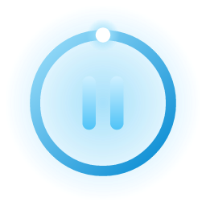

<div align="center">



# BreathPause

**A small breathing bubble that sits on your screen while you work.**

[](LICENSE)


</div>

BreathPause keeps a little bubble in the corner of your screen. It breathes slowly while you focus, and when your pomodoro timer runs out it fills the screen and walks you through a short breathing break. Then it's back to work.

## What you can do with it

- Breathe along with the bubble, or just let it remind you to slow down
- Set your own work and break times (25 / 5 minutes to start)
- Make your own breathing patterns: inhale, exhale, hold, as long as you like
- Pick a look: an orb, a sleepy seal, a bear, a jellyfish, or your own SVG
- Play soft breathing music that follows the pattern
- Use hotkeys to pause, skip or hide the bubble from anywhere

Everything stays on your computer. The only thing BreathPause sends out is a once-a-day check for a new version, and you can turn that off in Settings.

## Install

Grab the latest version from the [BreathPause website](https://markus-wildgruber.github.io/breathpause/) or the [Releases page](https://github.com/Markus-Wildgruber/breathpause/releases).

**Windows:** run `breathpause_x.y.z_x64-setup.exe`. No admin rights needed. If you'd rather not install anything, the `standalone.exe` runs on its own.

**macOS:** open the `.dmg` and drag BreathPause into Applications.

BreathPause isn't code-signed yet, so the first launch shows a warning. On Windows, click **More info → Run anyway**. On a Mac, right-click the app and choose **Open**.

**Updates:** installed copies update themselves from Settings › About. The standalone version tells you when a new one is out and links to the download.

## Getting started

Start BreathPause and the bubble appears in the top-right corner. Hover over it to edit, open settings or hide it. The tray icon has the rest: pause, music, settings and exit.

## For developers

You need [Rust](https://rustup.rs) and [Node.js](https://nodejs.org).

```bash
cd app
npm install
npm test          # unit tests
npx tauri dev     # run the app
```

Built with Tauri v2 and Svelte. Ideas, bug reports and new skins are welcome. Just open an issue or a pull request.

## License

[MIT](LICENSE) © 2026 Markus Wildgruber
